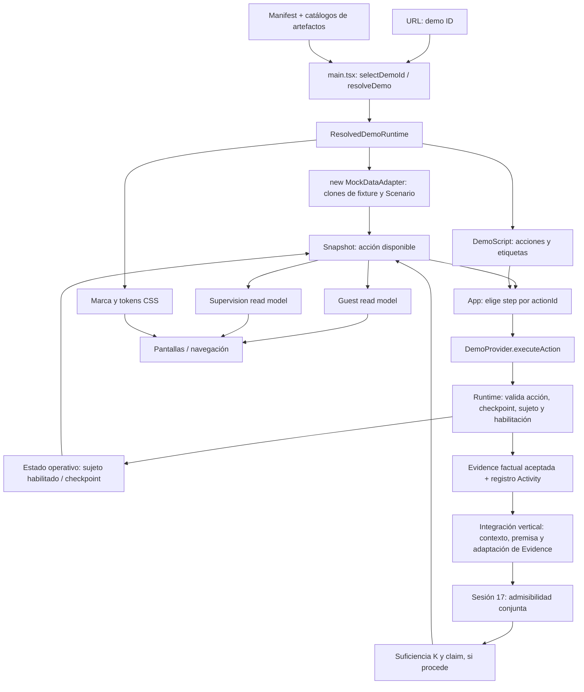

# Sesión 21 — Auditoría de frontera de composición y formulación H21

## SESSION 20 FINAL STATUS

La [Sesión 20 v1.3](session-20-first-family-adventure-vertical.md) quedó cerrada antes de iniciar este documento. La aceptación corresponde a Aventura Familiar A, su recorrido local y su presentación corregida. No acredita reutilización entre composiciones.

```text
SESSION 20 FINAL STATUS → CLOSED
EXACT 22-STEP ACCEPTANCE RESULT → 22/22 PASS
MANUAL BROWSER ACCEPTANCE → PASS
FIRST VERTICAL DEMO → EXECUTABLE WITH PRESENTATION GAPS
```

Se reutilizaron las observaciones y capturas del navegador del 8 de septiembre, con cotejo exacto e inspección de capturas el 12. El informe distingue resultados visibles del orden interno de evaluación corroborado por el código. No se hizo una nueva ejecución de navegador ni una nueva suite de pruebas para esta auditoría documental. La recomprobación focalizada previa del día 12 pasó 10/10; los 82 tests y demás checks completos corresponden al día 8.

## Resultado del audit y alcance

**Hay separaciones aprovechables, pero todavía no evidencia de un pipeline completo independiente de la composición A.** Las dependencias observadas incluyen el contexto fijo de evaluación, la selección de capacidades por identidad de Scenario, la narrativa de pistas dentro del adaptador y nombres fijos dentro de proyecciones y pantallas. Son hallazgos por inspección, no resultados de una ejecución de B.

El dato situado presente en un read model no es una fuga si procede del Scenario/fixture. La UI puede mostrar Lucía; lo problemático es que decida que P1 siempre se llama Lucía. Igualmente, una superficie de Aventura Familiar puede compartirse entre dos composiciones de esa misma Experience sin convertirse en un renderizador universal.

Esta entrega contiene el audit y el protocolo previo al experimento. No se implementa B, no se refactoriza, no se crea catálogo/selector ni se consolida H21.

## CURRENT FACTORY PIPELINE



El diagrama representa dependencias de ejecución, no un bucle automático: la siguiente acción exige otro clic. El alistamiento/activación actualiza el estado operativo sin pasar por la incorporación de Evidence. `reset()` restaura clones, checkpoint, estados iniciales, Evidence vacía y evaluación no intentada.

**Fronteras efectivas:**

- Composición: selección de referencias y datos iniciales. `DemoCatalogs` es un registro estático existente, no un catálogo visual nuevo.
- Runtime fact: Evidence incorporada después de una acción válida. El payload previamente declarado en Script es entrada simulada propuesta, no un hecho ya ocurrido en la sesión.
- Estado operativo: `subjectStates` y `checkpoint` privados por instancia; `initialSubjectStates` es su semilla declarativa, no su estado actual.
- Derived evaluation: `evaluation`, sus determinaciones y su claim. Se produce después de recibir Evidence, con los evaluadores existentes.
- Read models: snapshots, contadores, mensajes, lista de Evidence para supervisión y disponibilidad proyectada. `availableActionId` es derivado del estado, no permiso concedido por la UI.
- UI local state: ruta, carga, errores y la copia recibida del snapshot. `setSnapshot()` no convierte React en dueño del hecho ni de la evaluación.

## DEPENDENCY MAP

Las líneas corresponden al código inspeccionado el 12 de septiembre; los enlaces apuntan a archivos estables.

| ID | Dependencia observada | Evidencia y consecuencia |
| --- | --- | --- |
| D01 | Manifest → artefactos registrados → instancia del provider | [manifests.ts](../prototype/src/demo-factory/manifests.ts), [bootstrap.ts](../prototype/src/demo-factory/bootstrap.ts), `resolveDemo()`. Es una frontera real de resolución reutilizable. |
| D02 | Branding → tokens/logo → App | [artifacts.ts](../prototype/src/demo-factory/artifacts.ts), `brands`; [main.tsx](../prototype/src/main.tsx):23–25; [App.tsx](../prototype/src/app/App.tsx):457–463. Consumo de datos correcto, salvo los literales paralelos D03. |
| D03 | App → Aurora Stay / Lucía / jardín / fuente | `App.tsx`:113–115, 356. La pantalla compartida conoce valores de A sin recibirlos. |
| D04 | Scenario → sesión, sujetos, acciones → Runtime | [contracts.ts](../prototype/src/demo-factory/contracts.ts), `ScenarioDefinition`; `artifacts.ts`:76–130; [mock-adapter.ts](../prototype/src/demo/mock-adapter.ts):132–160. Datos iniciales y guardas distinguibles. |
| D05 | Runtime y projectSnapshot → `scenario.id === family-adventure` | `mock-adapter.ts`:81,165. Selecciona evaluación y perspectivas por una identidad concreta de Scenario. |
| D06 | Runtime → nombres de pistas y criterio literal `subject-p1` | `mock-adapter.ts`:169–173. Registra narrativa situada en maquinaria compartida. |
| D07 | Integración → contexto/premisa/scope constantes de A | [vertical-evaluation.ts](../prototype/src/demo-factory/vertical-evaluation.ts):28–69. Reescribe hunt/stay/property/booking usando constantes, sin tomar `EvidenceInput.contexts` ni Scenario como entrada. |
| D08 | Guest projection → P1/P2, Lucía, aventura y lugares | `vertical-evaluation.ts`, `projectGuestPerspective()`. Mezcla derivación de mensajes con identidades y contenido de A. |
| D09 | Supervision projection → datos recibidos | `vertical-evaluation.ts`, `projectSupervisionPerspective()`. Mapea sujetos/Evidence y copia resultados; no conoce Aurora ni Lucía. El hardcode de nombre lo añade App. |
| D10 | App → Script por acción disponible | `App.tsx`:449,536–544. Etiqueta y acción se obtienen por la misma identidad; la UI no ejecuta reglas de K. |
| D11 | Contratos compartidos → formas experimentales de aventura | `contracts.ts`: AppSnapshot, GuestPerspectiveReadModel, DemoEnableAction, DemoSubjectState, DemoProvider. Alcance específico expuesto en tipos comunes, sin prueba de generalidad. |
| D12 | UI de aventura → presencia de guestPerspective | `App.tsx`:108,450–475; [global.css](../prototype/src/styles/global.css):334–360. Es selección de una superficie local; el nombre CSS no demuestra dependencia del cliente. |
| D13 | App → enlace concreto de composición A | `App.tsx`:182. Atajo explícito a A desde las otras demos; no es el mecanismo general de resolución. Para B se usará su URL directa. |
| D14 | Manifest visibleModules → UI | `manifests.ts` declara home/benefits/activity/profile; App usa rutas y navegación propias. No se aplica esa lista para construir la navegación de aventura. Es una brecha de composición existente, constante en H21. |

## CONFIGURATION / RESPONSIBILITY MATRIX

Las dos tablas se unen por ID. Cada dependencia tiene ubicación, responsabilidad actual/esperada y las cinco clasificaciones solicitadas. `Mixto` exige separar responsabilidades, no trasladar todo a configuración.

| ID / elemento | CURRENT LOCATION | CURRENT RESPONSIBILITY | EXPECTED RESPONSIBILITY |
| --- | --- | --- | --- |
| M01 Aurora Stay / marca | artifacts.brands; App:113 | Datos de marca correctos más literal duplicado en pantalla | Composición selecciona marca; pantalla consume nombre/logo resueltos. |
| M02 Lucía | fixtures.member; guest projection; App:356 | Perfil situado más dos decisiones de nombre independientes | Nombre desde fixture/Scenario y asociación explícita con sujeto; proyección lo transporta. |
| M03 Nombres visibles P1/P2 | Scenario.subjects; guest projection; App:356 | Referencias individuales más etiquetas y comparaciones literales | Conservar P1/P2 como sujetos del control; sus nombres visibles son datos. La asignación sesión→sujeto no depende del texto. |
| M04 property/stay/booking | Scenario.contexts, Script.evidence.contexts; integration constants | Contexto declarado y contexto real de evaluación divergentes en procedencia | Contexto situado coherente; atribución factual conservada al recibir Evidence; evaluación valida aplicabilidad. |
| M05 Aventura Familiar / Experience | artifacts.experiences; guest projection | Definición referenciada y nombre duplicado | Experience permanece constante; su identidad/nombre resueltos pueden llegar al read model. |
| M06 Pistas y copy | Script labels; App:115; guest projection; adapter:170 | Contenido situado mezclado con mensajes de estado y Activity | Descripción/lugar de pista son contenido; hecho del hallazgo sigue en runtime. |
| M07 Labels de acciones | Script.presenterLabel → App | Texto de la acción ejecutable actual | Responsabilidad legítima de Script/presentación; mantener validación de acción en runtime. |
| M08 operationalSessionSubjectRef | Scenario, adapter guards, supervision | Selección de sujeto de sesión y aplicación de restricción operativa | La referencia inicial es situada; la identidad de sesión operativa y su relación con habilitación se respetan durante ejecución. No representa autenticación. |
| M09 DemoEnableAction | contracts; Script; DemoProvider; adapter | Solicitud pública local enlist/activate | Mantener semántica de comando invariante entre A/B. No volverla dato factual ni contrato productivo. |
| M10 DemoSubjectState | contracts; initialSubjectStates; adapter | Vocabulario y semilla de estado, más estado actual privado | Semilla en Scenario; estado actual en runtime; etiqueta visible en proyección. |
| M11 Guest projection | vertical-evaluation | Contadores/estado de lectura y narrativa fija | Proyectar hechos/evaluación con contenido situado suministrado; no cambiar K ni generar Evidence. |
| M12 Supervision projection | vertical-evaluation | Transcripción de sujetos, Evidence, cuenta y determinaciones | Mantenerla derivada de las mismas entradas; no evaluar de nuevo ni inventar nombres. |
| M13 UI específica | App HomePage/SystemPage/AppShell | Render, selección de pasos, navegación; algunos literales A | Compartir estas superficies para la misma Experience; nombres/lugares resueltos. La especialización de vista no exige motor general. |
| M14 Styles específicos | global.css .adventure-*; brand tokens | Layout, estados de navegación y colores | CSS compartido constante; variación visual mediante los tokens existentes cuando baste. |
| M15 Identidad family-adventure en adapter | projectSnapshot y executeAction | Interruptor de evaluación/proyecciones | La composición debe poder seleccionar un comportamiento existente sin depender accidentalmente de la identidad de un escenario situado. El mecanismo futuro no se diseña aquí. |
| M16 Payload de Evidence del Script | artifacts.scripts | Entrada simulada A/B preparada antes de actuar | Dato de estímulo; solo la acción aceptada lo incorpora como Evidence factual. |
| M17 Evidence aceptada / Activity | adapter.evidence, fixture.activityRecords | Registro factual por instancia y registro para actividad | Runtime conserva hechos y procedencia; Activity es registro/proyección, no autoridad de K. Narrativa del registro no debe identificar al resort. |
| M18 Contexto, premisa y criterio | vertical-evaluation constants | Inputs de evaluación ligados a A | K y requisitos de autoridad permanecen fijos; vinculación del scope al contexto situado debe ser coherente y explícita. Un fixture de premisa no es acreditación productiva. |
| M19 K established / derived claim | evaluation private; evaluadores | Determinación calculada con Evidence admitida | Resultado derivado, nunca flag de configuración o checkbox de UI. |
| M20 Copia de snapshot, ruta y errores | App useState / router | Consumir resultado y manejar interacción local | Read model almacenado en UI sigue siendo copia; ruta/errores son estado local, sin poder factual. |
| M21 visibleModules y capacidades | Manifest, bootstrap, App | Declaración parcialmente desconectada de navegación | Distinguir petición de composición de comportamiento efectivo. Mantener constante en este ensayo; registrar la limitación. |

| ID | IS SITUATED DATA? | IS RUNTIME STATE? | IS DERIVED RESULT? | IS PRESENTATION? | IS REAL ARCHITECTURAL LEAK? |
| --- | --- | --- | --- | --- | --- |
| M01 | Sí | No | No | Sí | Sí, literal en App; no en BrandArtifact. |
| M02 | Sí | No, nombre | No | Sí | Sí, literales; no el campo member.name. |
| M03 | Sí, referencias y nombres | No, declaración | No | Sí, labels | Mixto: literals P1/P2 fijan decisiones; la referencia declarada no es fuga. |
| M04 | Sí, contexto | Sí, referencias en Evidence aceptada | No | Puede mostrarse | Sí, sustitución por contexto A en integración. |
| M05 | No, identidad de Experience controlada | No | No | Sí, nombre | Duplicación; no falsifica H21 sola porque Experience se mantiene. |
| M06 | Sí, lugares/textos | No, contenido | No; elegir mensaje usa estado | Sí | Sí donde adapter/proyección/pantalla fijan el lugar de A. |
| M07 | Sí | No, comando pendiente | No | Sí | No en la ruta Script → App actual. |
| M08 | Sí, referencia inicial | Sí, contexto operativo de la sesión | No | Sí al observarse | No en Scenario/guarda; sí en consumidores que asumen otro literal. |
| M09 | No, forma de comando | No; solicita transición | No | No | No demostrado: forma local que se mantendrá constante; no universal. |
| M10 | Semilla sí; enum no | Sí, valores actuales | No | Etiquetas, sí | No por el tipo; límites de generalidad pendientes. |
| M11 | Recibe sujetos, contiene copy fijo | No | Sí, lectura derivada; no evaluación nueva | Sí | Sí, Lucía/lugares y referencias literales dentro de lógica. |
| M12 | Transporta refs recibidas | No | Sí, proyección de resultados | Sí | No fuga de cliente encontrada en esta función. |
| M13 | Contiene algunos literales | Solo ruta/errores locales, no hechos | Consume; no evalúa | Sí | Sí por literales; no por existir una pantalla de aventura. |
| M14 | Solo tokens de marca | No | No | Sí | No por `.adventure-*`; colores genéricos blancos/error no prueban fuga de resort. |
| M15 | Identidad de Scenario | No; condiciona ejecución | Condiciona producción | Condiciona proyección | Sí, identidad situada usada como interruptor de comportamiento. |
| M16 | Sí, input simulado | No antes de aceptación | No | Label aparte | No por estar declarado; nunca debe precargar hechos actuales. |
| M17 | Contiene contexto factual | Sí | Activity visual derivada, no K | Sí en narrativa | Mixto: hechos correctos por instancia; copy exclusivo filtrado al adapter. |
| M18 | Scope sí; norma K no | No, inputs fijos de evaluación | No; son premisas/criterio | No | Sí por binding fijo A; no por exigir K/premisa. |
| M19 | Incluye refs de procedencia | Guardado en runtime, pero de naturaleza derivada | Sí | Solo al proyectarlo | No; moverlo a configuration sería una violación. |
| M20 | Copia puede contenerlo | No hecho autoritativo; UI local sí | Snapshot recibido, no recalculado | Sí | No fuga de cliente por guardar el read model en React. |
| M21 | Sí, selección de módulos | No | No | Sí | Brecha real declarativo/efectivo; fuera de variables de H21. |

## LEGITIMATE SITUATED DATA

BrandArtifact y sus recursos; display names; referencias de fixture/Scenario/Script; property/estancia/reserva; textos y presentación de pistas; labels de acciones; identificación inicial de sesión/sujetos; y estímulos simulados con fechas/procedencia. Los datos deben ser coherentes entre artefactos. No todo tiene hoy una entrada consumida para configurarlo: añadir un campo ignorado no prueba reutilización.

`fixture.member.id = guest-lucia-vega` y `Scenario.operationalSessionSubjectRef = subject-p1` pertenecen a referencias diferentes. La coincidencia narrativa actual no constituye un vínculo tipado. La segunda composición puede mantener P1/P2 y variar display names; no debe fingir que el nombre de cuenta establece por sí solo la identidad factual.

## RUNTIME-SPECIFIC DATA

Habilitación vigente, checkpoint vigente, Evidence aceptada y sus sujetos/contextos, historial de acciones materializado en Activity. En particular, `A@P1 existe` exige una acción pública válida. Un manifest no puede declarar A como ya aportada para hacer pasar el ensayo. El seed de Scenario tampoco sustituye la habilitación resultante del comando.

## DERIVED DATA

Admisibilidad conjunta, intento de suficiencia, determinación de K y claim con Evidence considerada; además los read models que los exponen. Los contadores de pistas son agregados de lectura; no equivalen a K. Dos sujetos habilitados no son dos Evidence. La cadena conceptual se mantiene:

```text
DEMO COMPOSITION != RUNTIME FACT != DERIVED EVALUATION != READ MODEL != UI LOCAL STATE
```

## ARCHITECTURAL LEAKS FOUND

| Hallazgo | Qué exigiría cambiar para B | Por qué / responsabilidad filtrada | Frontera presionada |
| --- | --- | --- | --- |
| L1 Contexto factual normalizado a A | Binding en `toCrossSubjectEvidence()` y entradas de `evaluateVerticalEvidence()` | Ignora contexts del payload y usa scope fijo de Aurora. Cambiar solo Scenario/Script puede dejar evaluación silenciosamente situada en A. | Datos situados y hechos → integración de evaluación. |
| L2 Selección por scenario.id | Gate de evaluación y proyecciones en adapter | Un Scenario B con id diferente no recibe las perspectivas/evaluación. Conservar el mismo id puede mantener el gate, pero no resuelve L1/L3/L4. No se asumirá que id y referencia sean intercambiables. | Identidad de composición → selección de maquinaria. |
| L3 Narrativa e identidad en guest projection | Consumir contenido/nombres desde una entrada legítima | Cambiar fixture a otro nombre no cambia la frase de Lucía; cambiar lugares no cambia jardín/fuente. | Contenido situado → read model. |
| L4 Narrativa e identidad en App | Encabezado Aurora, Lucía y descripción de pistas | Logo/nombre de cuenta parametrizados coexisten con textos fijos. B mostraría contenido de A aunque ejecutara acciones. | Read model/branding → pantalla compartida. |
| L5 Narrativa en Runtime Activity | Asignación de título/description y comparación con subject-p1 | Guardas de habilitación disparan además una narrativa de pista concreta. Es responsabilidad de presentación situada mezclada con registro operativo. | Hecho aceptado → representación de actividad. |

**STOP BEFORE ABSTRACTING:** estas necesidades se documentan; ninguna se arregla en esta entrega. La lectura predice presión sobre H21, pero no se etiqueta la hipótesis como falsificada sin ejecutar el ensayo definido.

No se atribuyen estas fugas a los evaluadores de Sesión 17: reciben Evidence/contexto/criterio/premisa como argumentos. El acoplamiento de L1 está en el adaptador de integración vertical que los invoca.

Otras observaciones, sin convertirlas en refactorización: `resolveDemo()` valida referencias y el primer step, no todos los pasos ni la consistencia completa de sujetos/contextos; `initialCheckpoint` de Script no determina la inicialización del adapter, que usa Scenario; `availableActionId` y executeAction repiten parte de la decisión de disponibilidad/permiso; el historial de Lisboa del fixture compartido es dato situado heredado, no Evidence de la aventura. Deben figurar en diagnósticos de B si afectan el ensayo.

## LOCAL EXPERIMENTAL SHAPES — that recur or do not recur

| Forma | Recurrencia observada hoy | Lo que B pondrá a prueba |
| --- | --- | --- |
| DemoManifest / resolveDemo / DemoProvider | Usados por Retail, llegada Hospitality y Aventura; provider separado por resolución. | Reutilización completa con dos composiciones de la misma Experience, no solo resolución. |
| Scenario / Script | Llegada y Aventura los usan; Aventura incorpora cuatro acciones. | Nuevos datos situados conservando comandos y semántica de transición. |
| DemoEnableAction / DemoSubjectState | Necesarios en Aventura; llegada/Retail no usan alistamiento o activación. | Recurrencia esperada en B por diseño; aún no observada. No demuestra contrato universal. |
| operationalSessionSubjectRef | Declarado y aplicado para Aventura A. | Misma función P1→P2 y diferente presentación sin perder atribución. |
| Guest / Supervision read models | Solo esta vertical conjunta. Supervision mapper no contiene nombres de cliente; guest sí. | Misma forma y lógica para B. Mantener estas dos perspectivas no acredita una taxonomía general. |
| EvidenceInput | Llegada y Aventura; interpretación opcional heredada en llegada. | Evidence neutral A/B/C constante para A/B; no introducir interpretación TES. |
| CrossSubjectEvaluationContext / AuthoritativePremise | Experimentos anteriores y wrapper vertical A; no dos contextos verticales independientes en producción. | Misma exigencia de scope/autoridad con binding situado coherente. Sin promoción ni acreditación nueva. |
| .adventure-* y componentes de aventura | Una superficie implementada, especializada en esta Experience. | Recurrencia entre resorts sin cambiar CSS/componentes. Un estilo específico de Experience puede ser compartido. |
| Comando/renderer de C | No hay acción C en la UI de A. C existe como alternativa del criterio y control negativo. | Mantener B igual: no añadir camino C exclusivamente para B. Los controles A+C/B+C pertenecen a pruebas del evaluador. |

El enum `group` y `TesEventInterpretation` ya existen en contratos y llegada Hospitality. No se introducen ni se usan para A/B, cuyos dos sujetos permanecen individuales. La ausencia de nuevos conceptos no significa que se haya eliminado código histórico fuera del ensayo.

## H21 FINAL FORMULATION

**H21 — Composition Boundary / Factory Reusability.** Formulación final para el protocolo de este ensayo, hipótesis provisional sin consolidación:

> Con el pipeline de ejecución de la Sesión 20 congelado, una segunda composición B que conserva la misma Experience, dos sujetos individuales P1/P2 y las invariantes de alistamiento, activación, atribución y suficiencia de A puede resolverse y recorrer sus acciones mediante la misma maquinaria de runtime, evaluación, proyección y pantalla, cambiando únicamente artefactos y datos legítimamente situados y su registro. Las instancias conservan hechos y resets independientes, y cada una presenta y evalúa su propio contexto sin contenido ni referencias indebidas de la otra.

No basta con compilar, resolver B o cambiar el logo. Deben cumplirse simultáneamente identidad de maquinaria, integridad contextual, recorrido completo, aislamiento y ausencia de contenido A en B. La hipótesis no afirma reutilización entre distintas Experiences ni permite modificar los resultados derivados mediante configuración.

```text
H21 → FORMULATED / NOT TESTED / NOT CONSOLIDATED
Composition B → PROPOSED / NOT IMPLEMENTED
```

## CONTROLLED VARIABLES

Experience `experience:family-adventure@1`, su semántica; dos sujetos individuales y las referencias de control `subject-p1` / `subject-p2`; sesión P1; comandos enlist y activate; Evidence A/B/C y atribución A/P1 y B/P2; K `A AND (B OR C)`; requisitos de premisa; evaluadores; orden y guardas del recorrido; runtime semantics; guest/supervision perspectives; idioma español; rutas y mecanismo query; CSS compartido. Se conservan los mismos actionIds, tipos de marker y checkpoints para no mezclar variación narrativa con variación de interacción. P1/P2 pueden tener los mismos IDs locales en dos instancias sin ser una identidad global ni un Group.

## VARIABLES CHANGED FOR COMPOSITION B

Ejemplo de fixture sintético para el futuro ensayo; estos valores son una propuesta documental, no artefactos registrados:

| Variable | A actual | B propuesta | Motivo |
| --- | --- | --- | --- |
| demoId / prospectId | hospitality-family-adventure / aurora-hospitality-group | hospitality-family-adventure-costa / costa-fixture | Composiciones distinguibles. |
| brandRef, logo, tokens | Aurora Stay | Costa Clara Resort, recurso local y tokens propios | Datos de marca. |
| propertyRef | aurora-resort | costa-clara-resort | Contexto situado independiente. |
| bookingRef / stayRef | AS-8842 / stay-AS-8842 | CC-205 / stay-CC-205 | Referencias de estancia coherentes y distintas. |
| fixtureRef | fixture:hospitality-stay@1 | fixture:family-adventure-costa@1 | Datos de cuenta/historial sin restos de Aurora. |
| display names | Lucía / Huésped 2 | Inés / Mateo | Variación de nombres, P1/P2 permanecen individuales. |
| Scenario / Script refs | scenario:family-adventure@1 / script:family-adventure@1 | scenario:family-adventure-costa@1 / script:family-adventure-costa@1 | Nuevas instancias declaradas de la misma Experience. |
| scenario.id y script.id | family-adventure | family-adventure-costa | Identidad situada distinta; registra el bloqueo L2 si ocurre. No añadir alias para esconderlo. |
| presentación de pistas | jardín / fuente | mirador / patio | Cambia el lugar y copy; A y B como markers no cambian. |
| labels | Alistarme, activar huésped 2, jardín/fuente | Misma intención; mirador/patio y nombres situados | Mismo comando y atribución, distinto texto. |
| estímulos y procedencia situada | evidence-a-p1 / evidence-b-p2 con contexto AS | IDs de Evidence locales B y contexto CC | Distinguir hechos entre ejecuciones. Fuente simulada y fiabilidad se mantienen. |

La nueva estancia exige un binding coherente de hunt/evaluation refs y del scope de criterio/premisa. Es una consecuencia de cambiar contexto, no permiso para inventar una nueva autoridad o variar K. Hoy ese binding no es consumido desde la composición por `evaluateVerticalEvidence()`: se registra como L1 y punto de parada. No se simula su resolución con un campo de configuración inerte ni editando el evaluador.

## FILES EXPECTED TO CHANGE

Para esta entrega solo cambian documentos: Sesión 20, su enlace antiguo, este audit y el índice del producto.

En el futuro ensayo, la lista permitida inicial sería:

| Archivo/área | Cambio permitido |
| --- | --- |
| `prototype/src/demo-factory/manifests.ts` | Añadir manifest B y su registro. |
| `prototype/src/demo-factory/artifacts.ts` | Añadir instancias brand/Scenario/Script de B; conservar A. El archivo también contiene Experience, que no se modifica. |
| `prototype/src/demo-factory/fixtures.ts` | Añadir fixture B, sin copiar contenido situado de A inadvertidamente. |
| `prototype/src/demo-factory/bootstrap.ts` | Solo import/registro de fixture B en `defaultDemoCatalogs`; ninguna modificación de resolución, validación o construcción del provider. |
| Recurso local de branding/contenido B | Activo y datos declarativos que dispongan de una entrada consumida legítimamente. |
| Test focalizado futuro de H21 y registro de evidencias | Harness que observe las dos composiciones usando los exports reales, sin mocks de comportamiento ni monkey patching. |

Modificar una instancia de ScenarioDefinition no equivale a modificar la semántica del tipo compartido. Si los campos existentes no transportan lo necesario y se necesitan tipos/consumidores nuevos, documentar esa necesidad y detener el ensayo antes de implementarla. El permiso para añadir datos de presentación no permite introducir funciones, código ejecutable, resultados precalculados o un segundo renderer dentro del manifest.

## FILES EXPECTED NOT TO CHANGE

- `prototype/src/demo/mock-adapter.ts`, incluida disponibilidad, Activity, clonación y reset.
- `DemoProvider` y las formas/semánticas de comando y estado en `prototype/src/demo-factory/contracts.ts`.
- `prototype/src/demo-factory/cross-subject-evidence-admissibility.ts` y `evidence-sufficiency.ts`.
- `prototype/src/demo-factory/vertical-evaluation.ts`, incluidos binding y proyecciones: mover sus constantes o cambiar su firma ya es un cambio del pipeline congelado y exige parar.
- `prototype/src/app/App.tsx`, `src/ui/`, `src/styles/global.css`, `src/main.tsx` y lógica de bootstrap (excepto registro).
- Experience, contrato semántico, Architecture v0.5, ADR-001–005, PSC-P01 y activos de A.

La congelación incluye tanto comportamiento como extracción de literales requerida para B: no se admite refactorizar primero y presentar luego el ensayo como si B hubiese entrado sin cambios compartidos. Una eventual reparación posterior tendría su propia baseline y su propio resultado.

## Protocolo de ensayo futuro e independencia

1. Congelar A y las huellas del código compartido. Registrar constantes/variables y el diff permitido.
2. Preparar B solo con la lista permitida y resolver ambos IDs mediante `resolveDemo`. Usar el registro existente o `DemoCatalogs` en tests, sin alterar su algoritmo. URLs separadas son suficientes; no se construye selector.
3. Si aparece una necesidad de cambiar el pipeline, conservar el punto de fallo y parar antes de abstraer. Hasta ese punto, distinguir fallo estático, error de resolución y comportamiento observado; no sustituir una ejecución inexistente por una predicción.
4. Si ambos se resuelven y ejecutan, mantener providers A/B distintos en un mismo proceso para las pruebas de aislamiento. Registrar snapshots antes y después de cada comando. En navegador comprobar los dos URLs; pestañas independientes no bastan por sí solas para demostrar ausencia de estado compartido en módulos.
5. Intercalar: A enlist → B intacta; B enlist → A intacta; A produce A@P1 → B sin Evidence; B llega al resultado → A sin cambios; reset A → B conserva resultado. Repetir a la inversa y verificar semillas independientes.
6. En todas las fases comparar por separado hechos, contexto del input del evaluador, read models, contenido visible y cuenta operativa. Tener arrays distintos no evita que ambas evaluaciones se sitúen en Aurora.
7. Verificar la misma secuencia exacta de 22 pasos para B; controles A+B positivo, A+C positivo a nivel evaluador y B+C negativo. No forzar C en UI si A no lo permite.
8. Confirmar que las huellas de runtime/evaluadores/proyecciones/pantallas no cambian y que ambos usan las mismas implementaciones. No cuentan clones de código, wrappers exclusivos de B ni providers distintos disfrazados.

| Propiedad requerida | Observación para decidir | Estado de evidencia actual |
| --- | --- | --- |
| composition A != composition B | Refs/brand/contexto/fixture situados distintos; Experience igual | B no creada. |
| runtime state A != runtime state B | Providers distintos y evolución independiente de sus hechos | Clonación por instancia observada en código; A/B todavía no probado. |
| state A does not leak into B | Snapshots y Evidence de B intactos ante acciones A; prueba inversa | Pendiente del ensayo. |
| content A does not leak into B | No Aurora/Lucía/jardín/fuente/refs AS indebidos en B | Dependencias fijas detectadas; resultado de B aún no observado. |
| reset A does not mutate B | B conserva estado completo tras reset A | Pendiente del ensayo A/B. |
| both use same execution machinery | Mismas implementaciones y huellas congeladas, sin ramas nuevas por B | Mecanismo base existe; reutilización completa aún no probada. |

## FALSIFICATION CONDITIONS

H21 quedaría refutada **para la baseline congelada y este ámbito** si introducir diferencias situadas legítimas requiere cambiar runtime, evaluadores, proyección o componentes compartidos; si B no produce la misma interacción con entradas equivalentes; si el hecho o resultado se atribuye al contexto de A; si la presentación conserva datos situados de A; si reset/acciones contaminan la otra instancia; o si conseguir el resultado exige preconfigurar hechos/claims, duplicar maquinaria o introducir una rama exclusiva de B.

Un typo de manifest o un activo ausente no constituye por sí solo falsación arquitectónica: corregir el artefacto dentro del alcance permitido y repetir ese paso. Un fallo del navegador/entorno es inconcluso. Los hallazgos L1–L5 permiten anticipar dónde fallaría el ensayo, pero no se convierten aquí en un veredicto empírico.

## STOP CONDITIONS

Detenerse antes del primer cambio compartido necesario. Registrar: comando/entrada, estado y salida esperada/real, archivo/línea que exigiría modificación, motivo, responsabilidad filtrada y frontera presionada. No añadir abstracciones para completar B a toda costa.

También detenerse si hace falta variar Experience, K, autoridad exigida, atribución, subjects individuales, semántica de habilitación o perspectivas; si se intenta usar configuración como hecho/evaluación; si la variante implica nueva ontología o modificar los documentos gobernados. No crear DemoTemplate, DemoTenant, ClientConfiguration, UniversalRenderer, VerticalEngine, ExperienceEngine, PerspectiveRegistry, FactoryEngine ni arquitectura de plugins o equivalentes.

```text
AUDIT → COMPLETED
H21 → FORMULATED / NOT TESTED / NOT CONSOLIDATED
COMPOSITION B → NOT IMPLEMENTED
CATALOG / SELECTOR → NOT BUILT
ARCHITECTURAL REFACTOR → NOT PERFORMED
Architecture v0.5 → ACTIVE / unchanged
ADR-001–005 → ACCEPTED / unchanged
TES → unchanged
Product Semantic Contract → unchanged
PSC-P01 → unchanged
Group → NOT INTRODUCED
PSC-P02 → NOT CREATED
```

La entrega conserva una distinción verificable: el cierre de A está respaldado por aceptación; los acoplamientos están respaldados por inspección de fuentes; la reutilización A/B sigue siendo una hipótesis pendiente de experimento.
