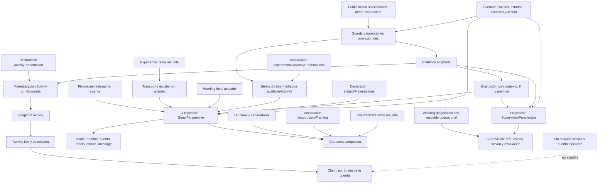

---
title: "Sesión 36 — Presentation Authority Provenance Stratification Audit"
language: es
version: "v1.0"
status: "CLOSED / H36 FALSIFIED as exhaustive compatible-meaning claim; four audit modes remain partially useful and qualified"
date: "2026-09-19"
project: "Convercus Demo Factory / Convercus Experience Products"
document_type: "auditoría transversal de fuentes y evidencia experimental histórica"
semantic_authority: "subordinado a TES, Architecture v0.5 y ADR-001–005"
---

# Sesión 36 — Presentation Authority Provenance Stratification Audit

## H35 CONSOLIDATED INPUT

[S35](session-35-experience-sourced-guest-experience-name-provenance.md) se recibe CLOSED / SUPPORTED WITH QUALIFICATION. ExperienceDefinition.name → GP.huntName es transporte de denominación semántica existente, con correspondencia local demostrada y App consumidor preservado. No se reconstruyen ni revisan los veredictos anteriores.

L3a/H28, L3b/H27, L3c/H29–H30, L4 framing/H32, L4 sujeto supervisor/H33, L4 sesión supervisora/H34, L4 huntName/H35 y L5/H25 permanecen experimentalmente abordados dentro de sus variables. Eso no constituye una certificación de todo significado de todo texto preservado. H25–H35 siguen en cuarentena.

Architecture v0.5 ACTIVE, ADR-001–005 ACCEPTED, TES y Product Semantic Contract unchanged; PSC-P01 OPEN / EVIDENCE-BACKED PRESSURE unchanged; PSC-P02 NOT CREATED.

## H36 HYPOTHESIS

Se contrasta la proposición fuerte del protocolo: **cada afirmación significativa de las superficies abordadas tiene una autoridad explícita compatible con su significado**, clasificable sin propietario universal ni App como autoridad semántica.

Resultado: **FALSIFIED para esa cobertura exhaustiva**. Hay trazabilidad completa del origen de las palabras estudiadas, pero no de todas las relaciones que esas palabras afirman. En Activity H25, «por ti» y «registrado desde tu cuenta» exceden la atribución operacional disponible. Tratar su declaración editorial como prueba de viewer/ejecutor/cuenta salvaría el resultado precisamente mediante la confusión prohibida.

Los modos U/D/O/E conservan utilidad parcial y cualificada. No se confunde ese resultado más débil con haber demostrado la hipótesis completa. No se inventa un quinto modo para absorber afirmaciones sin autoridad.

## AUDIT SCOPE

Auditoría transversal H25–H35, incluyendo los STOP H24/H26/H31 y las superficies congeladas que forman parte de esas variables. Unidad: fragmento significativo y afirmación que resulta de combinar fragmentos. Matriz de 36 unidades; las filas de composición hacen explícitas relaciones que no pueden esconderse descomponiendo palabras.

**CODE DELTA → NONE. TEST-INFRASTRUCTURE DELTA → NONE.** Sólo se crean este informe y evidencia S36. No se repara el contenido detectado. No impide observar las fuentes, por lo que no hay bloqueo instrumental ni necesidad de alterar producto.

Lectura de fuentes vigentes y análisis de trazas históricas: EXECUTED. Suite actual, nueva ejecución runtime/DOM y validación visual: NOT EXECUTED. No hay delta que requiera repetir recorridos; las fuentes inspeccionadas coinciden con S35. No se presenta la lectura de JSON como nueva ejecución de App.

## PROVISIONAL AUTHORITY MODES

Se usan inicialmente los cuatro modos solicitados, sin alterar sus definiciones para lograr cobertura:

| Modo | Hipótesis inicial |
| --- | --- |
| U | Convención de forma/organización que no fabrica significado de dominio |
| D | Dato declarado cuyo campo y artefacto tienen responsabilidad sobre el significado presentado |
| O | Referencia, estado, hecho simulado o determinación derivada que autoriza una afirmación operacional acotada |
| E | Declaración editorial situada explícita; autoriza contenido, no prueba hechos o identidades |

Son categorías de auditoría, no capas, módulos, servicios, contratos, conceptos TES o fronteras de ownership. Un dato declarado puede participar operacionalmente: Scenario.subjects[].id se analiza como O por su responsabilidad en el runtime; el hecho de que esté declarado no obliga a clasificar todo como D. Este criterio es constante para GP y SP.

## UNIT OF ANALYSIS

«Mi aventura · Aurora Stay» contiene rótulo de canal U, separador U y nombre de marca D. El conjunto no adquiere una autoridad única por compartir un párrafo. GP.message no es una unidad homogénea: inicial, intermedio y completion tienen procedencias distintas.

También se analiza la combinación: «Pista del mirador registrada» relaciona una ocurrencia aceptada O con un lugar declarado editorialmente E. Enumerar dos fuentes sin verificar la relación entre ellas sería insuficiente. «Hallazgo aportado por ti» no se legitima clasificando “hallazgo” como O y “ti” como estilo: el pronombre establece una relación con el viewer que falta.

## CURRENT SOURCE VERIFICATION

[Baseline S36](evidence/session-36/baseline.json): 445 archivos recibidos, excluyendo dependencias/build, metadatos Finder, .git y tsbuildinfo. Se registra el working tree, no HEAD. No hay AGENTS.md aplicable encontrado en la ruta del proyecto o sus ancestros.

[Verificación de fuentes](evidence/session-36/current-source-verification.json): diez coincidencias SHA-256. App, bootstrap, adapter, projectors y harness H35 coinciden con los hashes de la traza S35; contratos, artefactos A/B, fixtures y manifests coinciden con la baseline preservada de S35. Esto comprueba continuidad de fuentes; no sustituye una ejecución.

Índice de fuentes de la matriz y [extractos numerados](evidence/session-36/current-source-excerpts.md):

| Clave | Fuente vigente | Responsabilidades inspeccionadas |
| --- | --- | --- |
| S1 | [contracts.ts](../prototype/src/demo-factory/contracts.ts) | Member, GP/SP, Evidence, Scenario, Script, Experience, Brand y runtime |
| S2A | [artifacts.ts](../prototype/src/demo-factory/artifacts.ts) | Marca/Experience A, sujetos, estados, sesión, acciones y declaraciones editoriales |
| S2B | [costa-artifacts.ts](../prototype/src/demo-factory/costa-artifacts.ts) | Las mismas responsabilidades en B |
| S3 | [fixtures.ts](../prototype/src/demo-factory/fixtures.ts) | Datos member y Activity inicial; no mapping de viewer/ejecutor |
| S4 | [bootstrap.ts](../prototype/src/demo-factory/bootstrap.ts) | Resolución por referencias y transporte separado de Experience.name |
| S5 | [mock-adapter.ts](../prototype/src/demo/mock-adapter.ts) | Guards, Evidence aceptada, materialización Activity y proyección de snapshot |
| S6 | [vertical-evaluation.ts](../prototype/src/demo-factory/vertical-evaluation.ts) | Evaluación, GP.message por ramas, mappings de estado y proyección SP |
| S7 | [App.tsx](../prototype/src/app/App.tsx) | Consumo de campos, composición de cabecera, cuenta y diagnóstico |

Se consultaron informes H24–H35 y trazas seleccionadas. [Extractos históricos verificables](evidence/session-36/historical-evidence-extracts.json) registran ruta JSON, hash de la traza y valores observados. Sus comparaciones recomputan igualdad de datos ya grabados; no ejecutan providers ni mocks nuevos.

## ADDRESSED SURFACE MATRIX

La matriz se divide en dos tablas enlazadas por ID para conservar legibilidad. Juntas registran los doce atributos requeridos por fragmento. [Versión estructurada completa](evidence/session-36/addressed-surface-matrix.json). “AUSENTE” es un resultado de auditoría, no un nuevo modo. “Factual” significa autoridad dentro de la demo simulada, no verificación de hechos reales.

| ID | Superficie / fragmento | Afirmación | Fuente | Relación | Modo candidato |
| --- | --- | --- | --- | --- | --- |
| M01 | Activity: ocurrencia aceptada | Evidence de hallazgo aceptada | Scenario guards + Public Action + runtime Evidence | Admitir, almacenar, evaluar | O |
| M02 | Activity: existencia de fila | Hay registro visible para esa ocurrencia | Aceptación O + presencia activityPresentation E; registros iniciales Fixture | Materialización conjunta tras acción | O + E |
| M03 | Activity.title | Hallazgo en jardín/fuente o mirador/patio | Script.step.activityPresentation.title; acción admitida | actionId enlaza contenido posterior | E + O |
| M04 | Activity.description: redacción | Descripción situada del hallazgo | Script.step.activityPresentation.description | Contenido posterior explícito por actionId | E + O |
| M05 | Activity.description A: «por ti» | Viewer es quien aportó el hallazgo | Sólo literal E; Evidence atribuye subject-p1 | Falta viewer → sujeto/ejecutor | E para copy; autoridad relacional AUSENTE |
| M06 | Activity.description: «desde tu cuenta» / «cuenta de Inés» | Hallazgo registrado desde cuenta identificada | Literal E; member y sessionSubjectRef no se vinculan al ejecutor | Falta relación cuenta → ejecución del hallazgo | E para copy; autoridad relacional AUSENTE |
| M07 | Activity.description B: Inés/Mateo | Alias humano en el relato editorial | activityPresentation separado de subjectPresentations | Declaración narrativa, no lookup de H27 | E |
| M08 | Activity id/fecha/provenance | Qué registro y cuándo, origen simulado | Evidence.id/occurredAt; adapter simulated | Copiar tras aceptación; fecha formateada UTC | O + U |
| M09 | GP.huntName / h1 | Denominación de Experience efectiva | ExperienceDefinition.name | Scenario.experienceRef resuelve Experience; copia escalar | D |
| M10 | GP.sessionLabel: «Cuenta de» | Marco de presentación de cuenta | Responsabilidad member/account documentada H26/H28 + convención | Aplicar marco a nombre de cuenta | U condicionado por D |
| M11 | GP.sessionLabel: nombre | Nombre mostrado de cuenta | Fixture.member.name | Copiar escalar accountName | D |
| M12 | GP.sessionLabel: frase completa | Cuenta presentada con ese nombre | Marco account-display + member.name | Concatenación con significado acotado | U + D |
| M13 | GP.subjects: existencia/ref | Estos sujetos pertenecen al Scenario | Scenario.subjects[].id | Mapear colección; H27 sólo etiqueta refs existentes | O (dato declarado de Scenario) |
| M14 | GP.subjects[].label | Etiqueta humana/situada del sujeto | Script.subjectPresentations | subjectRef coincide con id; label o vacío | E + O para selección |
| M15 | GP.subjects[].status: «Estado:» | Organiza lectura de estado | Convención de rótulo condicionada a estado existente | Prefijo | U subordinado a O |
| M16 | GP.status: enabled → habilitado | Sujeto habilitado operacionalmente | subjectStates[id] | Mapping finito preserva estado sin actor/género | O + U de wording |
| M17 | GP.status: not-enabled / not-enlisted | Sin habilitar / sin alistar | subjectStates[id] | Dos mappings distintos; ausencia no inventa estado GP | O + U |
| M18 | GP.message inicial | Aventura disponible; alistamiento pendiente | Sin Evidence + p1 not-enlisted; configuración canónica disponible | Rama inicial antes de E | O + U |
| M19 | GP.message intermedio | Exploración situada/registro y siguiente acción | availableActionId O + experimentalJourneyPresentations E | Seleccionar declaración por affordance vigente | O + E |
| M20 | GP.message completion | Pistas cumplen condición | evaluation.sufficiency established; K/premisa/Evidence/contexto | Rama prioritaria + verbalización acotada | O + U |
| M21 | GP.message como campo | Inicial/intermedio/final no comparten owner | Ramas M18/M19/M20 | Dispatch por condición; mismo campo de salida | O+U u O+E según rama |
| M22 | Eyebrow: «Mi aventura» | Nombre de vista/canal | Convención UI + responsabilidad de Home | Rótulo estable también usado en navegación | U cualificado |
| M23 | Eyebrow: separador · | Separación visual de fragmentos | Convención UI | Concatenar sin relación de identidad | U |
| M24 | Eyebrow: marca | Nombre de marca resuelta | BrandArtifact.name vía manifest.brandRef | Resolver y transportar prop | D |
| M25 | Párrafo introductorio | Marco editorial de composición | Script.experimentalIntroductoryFraming | Declaración estática; prop separada de marca | E |
| M26 | Cabecera compuesta | Canal + marca + Experience + intro | M09 + M22–M25 | Co-localización sin owner común | U + D + E |
| M27 | SP subject heading | Referencia operacional literal | SP.subjects[].id desde Scenario | Render exacto | O |
| M28 | SP subject detail ID | La misma referencia en detalle | SP.subjects[].id | Render exacto repetido | O |
| M29 | SP exists / state / Evidence count | Pertenencia, estado y recuento atribuido | Scenario subjects; subjectStates; Evidence.subjects | Mapear; fallback estado; contar por igualdad de id | O + U de rótulos |
| M30 | SP sesión: rótulo | El valor es ref del sujeto de sesión operativa | Relación Scenario.operationalSessionSubjectRef y guards | Verbalizar responsabilidad inspeccionada | U subordinado a O |
| M31 | SP.sessionSubjectRef | Referencia seleccionada para sesión operacional | Scenario.operationalSessionSubjectRef | Copia literal | O |
| M32 | SP par sesión | Sujeto de sesión operativa + subject-p1 | Relación operacional + valor + rótulo | Composición acotada | O + U |
| M33 | SP evaluación y claim | Admisibilidad, suficiencia, afirmación derivada | Evaluadores + Evidence + contexto + premisa + K | Proyectar determinaciones | O + U de rótulos |
| M34 | SP Evidence y atribución | IDs de Evidence y refs atribuidas | Evidence efectiva aceptada | Copiar refs/source; lista | O + U |
| M35 | GP contadores y pluralización | Número de pistas/registros atribuidos | evaluation.evidence.length y filtro por subject.id | Contar + singular/plural | O + U |
| M36 | Affordance observada como fuente rechazada | Copy previo a acción, no relato posterior | Script.presenterLabel + acción disponible | App selecciona botón por actionId | E + O de disponibilidad |

| ID | Transporte (fuente:líneas) | Consumidor | Factual / editorial | ¿Específico de composición? | ¿Varía con runtime? | Experimento / evidencia | Cualificación |
| --- | --- | --- | --- | --- | --- | --- | --- |
| M01 | S5:132–178 → evaluation | Adapter / SP / counts | Factual simulado | Contexto sí | Sí | H25 rechazos/ausencia | La declaración no causa aceptación; no realidad externa |
| M02 | S5:179–192 → activityRecords → snapshot.activity | ActivityList | Registro presentacional condicionado | Sí | Sí | H25 ausencia A/B | Sin E no hay fila nueva, aunque Evidence exista; no equiparar fila y hecho |
| M03 | S2A/S2B → S5 → snapshot.activity.title | S7:81 | Editorial, anclado a ocurrencia | Sí | Aparece tras acción | H24 STOP → H25 | marker-a no declara jardín; E no prueba lugar físico |
| M04 | S2A:203–240 / S2B:110–151 → S5 | S7:88 | Editorial | Sí | Aparece tras acción | H25 X/Y | Procedencia de palabras acreditada; todas sus relaciones no quedan por ello probadas |
| M05 | S2A:205 → S5 → snapshot.activity | S7:88 | Pretensión factual/perspectival no acreditada | A | Tras primera Evidence | H25 + H26/H30 no-viewer + traza H35 | Contraejemplo dentro del conjunto auditado; no crear quinto modo ni repararlo |
| M06 | S2A:240 / S2B:151 → S5 | S7:88 | Pretensión factual no acreditada | A/B | Tras segunda Evidence | H25 / H34 / H35 variants.account | Cambio de member deja Inés en Activity; no prueba que otra cuenta no exista, sí ausencia de garantía |
| M07 | S2B → S5 | ActivityList | Editorial; no identidad real | B | Tras acción | H25/H27/H35 variants.subjects | Puede divergir de label GP sin cambiar atribución por ID |
| M08 | S5:32–39,185–192 → snapshot | S7:89 | Factual simulado + formato | Sí | Sí | H25 / regresión H35 | La fecha formateada no prueba presencia física ni cambia timestamp |
| M09 | S4:126–163 → S5 → S6:146 | S7:118 | Metadata semántica declarada | Compartida A/B | No por acciones | H35 name/emptyName/id | No título de instancia/campaña; cadena vacía no valida UX |
| M10 | S6:147 | S7:137 | Presentación de cuenta | No el prefijo | No | H26 / H28 | No U autónomo; no acredita propiedad jurídica, autenticación, viewer ni sujeto |
| M11 | S3 → S5:87 → S6:147 | S7:137 | Dato de fixture, no identidad real verificada | Sí | No por acciones | H28 / H35 account | Nombre coincide con GP label sólo incidentalmente |
| M12 | S5/S6 | HomePage; eco S7:467 | Presentación compuesta | Sí | No | H28 independencia inversa | El nombre sessionLabel no añade autoridad de sesión |
| M13 | S2A/B → S5 → S6:148 | HomePage cards | Operacional | Mismos IDs A/B | Colección estable | H27 ausencia/unknown | Una entrada editorial desconocida no crea sujeto |
| M14 | S2 → S5 → S6:152 | S7:132 | Editorial | Sí | No por acciones | H26 STOP → H27 | No autentica persona; no autoridad SP |
| M15 | S6:154–158 | S7:133 | Forma lingüística | No | Presente si hay mapping | H29 | No basta un prefijo para afirmar estado |
| M16 | S5 → S6:154–158 | S7:133 | Derivado operacional | No | Sí | H29 exchangedStates / H35 | No dice quién habilitó, quién mira o para qué permiso productivo |
| M17 | S6:154–158 | S7:133 | Derivado operacional | No | Sí | H29 negativos | No colapsar estados por id P1/P2; no inferir actor |
| M18 | S6:162–165; Scenario A/B | S7:123 | Derivado con alcance local | No el wording | Sí | H30 inicial/ausencia / H35 | La condición no comprueba disponibilidad universal para Scenario arbitrario |
| M19 | S5:69–81 → S6:168–169 | S7:123 | Editorial situada, anclaje operacional | Sí | Sí | H30 X/Y/absence/mismatch | Contenido puede contradecir hechos sin cambiarlos |
| M20 | S6:63–127,143,162–163 | S7:123 | Derivado evaluativo | No el wording | Sí | H30 completion-negative / H35 | No recompensa/fin universal/TES Progression; texto no determina K |
| M21 | S6:162–170 | S7:123 | Mixto; no asignación única | Depende de rama | Sí | H30 | Falsador de one field → one authority; ausencia de acción no acredita completion |
| M22 | S7:117,475 | Header/nav | Organización UI | No | No | H31 inspección / H32 | Lectura posesiva literal de viewer no acreditada; no pronombre identificatorio |
| M23 | S7:117 | Header | Formato | No | No | H32 | No declara marca=propiedad ni marca=Experience |
| M24 | S4:109–115 → S7:483 | S7:117 | Configuración branding | Sí | No por acciones | H31 fuente / H32 X/Y | No property.name; no metadato semántico de Experience |
| M25 | S2A:179/S2B:90 → S7:483 | S7:119 | Editorial | Sí | No | H31 STOP → H32 | No estado, viewer ni autoridad factual; ausencia omite párrafo |
| M26 | Props/read model independientes | S7:116–120 | Mixto | Sí | No por acciones | H32 + H35 | La composición DOM no unifica autoridad ni permite intercambiar valores |
| M27 | S2 → S5 → S6:183–187 | S7:360 | Diagnóstico | Mismos IDs A/B | Estable | H33 orden/opaco | No P1 alias, nombre humano ni índice |
| M28 | S6:184 | S7:361 | Diagnóstico | Mismos IDs A/B | Estable | H33 | Repetición no añade relación |
| M29 | S6:183–193 | S7:361 | Derivado operacional | Sí los hechos | Sí | H33/H34/H35 | exists true = entrada suministrada; fallback no prueba estado observado universal |
| M30 | S5:145–161; S6:182 | S7:367 dt | Diagnóstico | No el rótulo | No | H34 | No cuenta/actor autenticado; ubicación App no autoriza semántica |
| M31 | S2 → S5:90–92 → S6:182 | S7:367 dd | Operacional | Mismo valor A/B | Estable | H34 p1/p2/opaco | Proyector no valida pertenencia; variantes aisladas no acreditan nuevo recorrido |
| M32 | M30/M31 | SystemPage | Diagnóstico compuesto | Mismo A/B | Estable | H34 | Cuenta/sesión histórica era overclaim, no U legítimo |
| M33 | S6:63–127,195–197 | S7:369–372 | Derivado evaluativo | Contexto sí | Sí | H25–H35 regresiones | No validación total de terminología; K visible sigue literal local inspeccionado |
| M34 | S6:189–194 | S7:375–378 | Factual simulado | Sí | Sí | H25/H33/H35 | No atribuir al nombre de member; refs no identidad del ejecutor |
| M35 | S6:142,159,171 | S7:125,133 | Derivado + forma | Sí el count | Sí | H26 inspección / H29–H35 | Cuenta registros; no unicidad de lugares/marcadores; pista exige alcance Family |
| M36 | S7:453,122–124,549–562 | Home action button | Editorial/operacional; control auxiliar | Sí | Sí | H24/H26/H30 independencia | No fuente autorizada para Activity/message; yo/mi cuenta quedan como challenge probes |

## H24 / H26 / H31 FALSIFICATION INPUT

| STOP | Qué no estaba autorizado | Ensayo posterior y límite preservado |
| --- | --- | --- |
| [H24](session-24-situated-activity-representation-provenance.md) FALSIFIED | Inferir relato posterior situado desde sujeto, affordance, marker o contexto | H25 declara activityPresentation por paso; no convierte copy en prueba del hecho |
| [H26](session-26-situated-guest-perspective-provenance.md) FALSIFIED | Identidad/label humano desde member o ref; narrativa presente desde Activity/presenterLabel | H27 declara labels; H28 usa cuenta; H29 acota estado; H30 declara narrativa intermedia. Viewer sigue sin relación |
| [H31](session-31-application-composition-framing-provenance.md) FALSIFIED | Inventar introducción desde marca, contexto o agregar otros contenidos | H32 declara intro; branding existente se transporta por separado |

Estos STOP son coherentes con distinguir conocimiento operacional, dato con responsabilidad específica y contenido editorial faltante. No prueban que toda carencia de significado pueda repararse declarando una frase. En particular, la relación viewer→sujeto no aparece por trasladar un literal a Script.

## H25 ACTIVITY AUTHORITY ANALYSIS

Tres cuestiones distintas, comprobadas en S5 y la [evidencia H25](session-25-script-bound-situated-activity-representation.md):

1. **Aceptación del hecho simulado:** guards de Scenario/checkpoint/estado/tipo/atribución admiten la Public Action; Evidence efectiva se almacena y evalúa. E no puede saltar una guard ni establecer K.
2. **Existencia de la fila visible:** para hallazgos Family, aceptación y presencia de activityPresentation son ambas necesarias. `if (presentation)` gobierna insertar la fila. Los controles históricos de ausencia conservan hechos/evaluación y eliminan esas filas. Clasificar la existencia de toda Activity como exclusivamente O sería incorrecto; clasificarla toda como E también.
3. **Contenido:** title/description se copian de E; id/occurredAt/provenance proceden del hecho aceptado y del adapter. Registros iniciales de fixture y rama genérica de Arrival conservan otras fuentes; no se universaliza H25.

Esta dependencia de materialización no convierte la editorial en autoridad del hecho. Sí refuta “todo dato de presentación puede faltar sin cambiar nada del runtime”: cambia la colección de registros presentacionales. El límite factual debe nombrarse exactamente.

**Contraejemplos de significado dentro de la variable H25:** A declara «Hallazgo aportado por ti» y «Hallazgo atribuido al huésped 2, registrado desde tu cuenta». B declara «Hallazgo atribuido a Mateo, registrado desde la cuenta de Inés». Hay autoridad E para las palabras; no hay dato de actor/cuenta ejecutora ni viewer relation en Public Action, Evidence, Scenario o read models. La atribución a subject-p1/p2 no prueba esas relaciones. H27 autoriza labels GP, no universaliza identidad o presentación.

La traza S35 aún muestra esos textos en Activity DOM. En B, variants.account cambia member.name a Cuenta H35 y GP a «Cuenta de Cuenta H35», mientras Activity mantiene «cuenta de Inés». No demuestra que Inés no pueda existir como otra cuenta; demuestra que la independencia de fuentes **no garantiza coherencia semántica ni una relación cuenta→ejecución**. Los datos no registran esa segunda cuenta como ejecutora. No se interpreta la igualdad canónica de nombres como prueba.

No se revoca H25: su hipótesis acotada demostraba procedencia de contenido y separación respecto de Evidence. S36 pregunta por cada afirmación significativa, una exigencia mayor que encuentra un límite real.

## H27 SUBJECT PRESENTATION ANALYSIS

S6 mapea Scenario.subjects y después busca la etiqueta E por subjectRef. Sin presentación sigue existiendo el sujeto con label vacío; una declaración con ref desconocida no crea sujeto. H27 lo observa en ausencia/unknown. Por tanto existencia/referencia O y etiqueta situada E son diferentes afirmaciones de la misma tarjeta.

Lucía/Inés/Mateo son labels declaradas, no verificación de identidad humana, autenticación o relación con member. Una variante de H35 cambia GP a Participante Alfa/Beta y conserva los nombres narrativos de Activity: hay fuentes editoriales independientes, no un display-name universal. No se corrige ni sincroniza esa divergencia en S36.

## H28 ACCOUNT PRESENTATION ANALYSIS

«Cuenta de Inés» se descompone en marco account-display y member.name. La responsabilidad de member como fuente de presentación de cuenta está documentada **antes de H28 en H26**, y el modelo member incluye nombre, nivel, puntos y antigüedad, separado de sujetos de Experience. H28 transporta ese nombre; los controles causales prueban independencia respecto de H27 y de sessionSubjectRef.

El prefijo **no es semánticamente vacío**. U por sí solo no autoriza “cuenta”. U+D es admisible únicamente con la responsabilidad acotada de presentación de cuenta recibida, sin inferir propiedad jurídica, autenticación, viewer o cuenta=sujeto. El string name aislado y la mera concatenación no probarían esas proposiciones. El nombre técnico sessionLabel tampoco añade autoridad de sesión.

No se usa “App ya lo decía” como justificación circular. El soporte consiste en la responsabilidad documental recibida y la fuente member correspondiente; la causalidad de H28 sólo prueba transporte, no amplía esa semántica. Cuentas/nombres son datos de fixture, no hechos personales verificados externamente. Si “Cuenta de” se leyera como autenticación o vínculo a la sesión operacional, esa lectura queda sin autoridad. Es una cualificación material del modo U, no un subtipo nuevo.

## H29 STATUS PRESENTATION ANALYSIS

S6 distingue not-enlisted, not-enabled y enabled. `Estado:` organiza la salida; subjectStates[id] autoriza el estado; “habilitado”, “sin habilitar” y “sin alistar” lo verbalizan. El mapping no introduce actor, causa personal, género ni identidad de viewer.

H29 exchangedStates cambia estados conservando IDs: el texto sigue al estado, no a P1/P2. Los negativos y el código muestran vacío GP si falta mapping; SP mantiene su fallback not-enabled existente, que no debe confundirse con un estado observado explícitamente. Son reglas locales, no política general.

El mapping cabe en O para la afirmación y U para la realización lingüística. No es una quinta autoridad: las categorías ya admiten transformación puramente presentacional. No se decide por vivir en el proyector. “Habilitado por ti”, en cambio, agregaría un actor sin soporte y fallaría ese mismo criterio.

## H30 MIXED MESSAGE AUTHORITY ANALYSIS

| Rama actual | Condición efectiva | Fuente del significado / wording | Límite |
| --- | --- | --- | --- |
| Inicial | Sin completion, Evidence.length=0 y p1 not-enlisted | O para alistamiento pendiente y configuración canónica disponible; U verbaliza | No comprueba disponibilidad universal ni actor; no generalizar a escenarios arbitrarios |
| Tres intermedias | availableActionId vigente, después de ramas prioritarias | O selecciona posición; E declara mensaje situado | ActionId no demuestra por sí solo lugar o identidad; mensaje puede mentir |
| Completion | evaluation.sufficiency=established, con prioridad | O: determinación bajo K/premisa/contexto; U: frase acotada | No determina recompensa, éxito global, identidad ni TES Progression |

Un mismo GP.message usa O+U u O+E según condición. Los controles históricos de ausencia eliminan sólo intermedios; inicial/final quedan. Contradiction cambia el mensaje a “La condición de la aventura está establecida en el observatorio” con determinaciones intactas. Mismatch no crea acción; ausencia de affordance no prueba completion. El control negativo de completion y la rama prioritaria evitan tratar editorial como evaluación.

El wording «Pista del mirador registrada» es una afirmación compuesta: aceptación/posición O y correspondencia situada E. El sentido operacional existe sin determinar esas palabras exactas. No se crea owner común para el campo.

## H32 COMPOSED HEADER AUTHORITY ANALYSIS

Cabecera actual: «Mi aventura · Aurora Stay», h1 «Aventura Familiar» y párrafo introductorio. M22–M26 separan U (canal/separador), D (marca), D (denominación de Experience, por H35) y E (intro). Marca y nombre semántico son datos distintos aun compartiendo modo de auditoría.

H32 perturba marca e intro independientemente; H35 perturba Experience.name con resto intacto. La intro estática no cambia con estado, Evidence o completion. El ensamblaje App no produce semántica nueva: consumir varias autoridades en un header no crea un objeto de dominio llamado “header authority”.

## H33 SUPERVISION SUBJECT ANALYSIS

El h2 y el detalle muestran exactamente SP.subjects[].id. Scenario/proyector suministran la referencia y la usan para estado y atribución. No hay parsing, alias P1/P2, índice, member o H27. Orden invertido y ref opaca fueron controles aislados de H33, no nuevos Scenarios productivos.

Es contraevidencia a que toda presentación legible necesite Script. No demuestra que una ref sea nombre humano ni que todo futuro diagnóstico pueda resolverse sin declaración. El valor técnico repetido conserva procedencia O.

## H34 SUPERVISION SESSION ANALYSIS

«Sujeto de sesión operativa» es wording UI respaldado por una relación O: Scenario.operationalSessionSubjectRef participa en guards de enlist/activate; SP lo transporta. El `dt` nombra esa responsabilidad, el `dd` presenta el valor. No es sólo derivación del nombre inglés del campo.

El proyector copia una ref opcional sin validar pertenencia. Las variantes p1/p2 y opaca demostraron transporte/render aislado, no nuevas rutas válidas ni autenticación. El rótulo antiguo «Cuenta/sesión operativa» agregaba un significado no respaldado: contraejemplo histórico directo de que un literal aparentemente genérico sea U legítimo.

H33/H34 refutan ownership universal de Script sin convertir todo texto operacional en derivación automática: hasta la selección de rótulo requiere comprobar qué relación existe.

## H35 EXPERIENCE NAME ANALYSIS

Experience.name llega por resolver → adapter → projectSnapshot → GP.huntName → h1. Su correspondencia con la denominación de Experience estaba documentada en S21/S26 y fue inspeccionada en H35; no se deduce de strings iguales. Id/name no son intercambiables; name no es título de campaña, instancia o composición.

Comparación D: Experience.name denomina un artefacto semántico; Brand.name configura branding; member.name presenta un dato de cuenta/fixture. Comparten una clase útil **sólo** porque cada valor se presenta bajo la responsabilidad de su fuente, sin reconstruirlo editorialmente. No comparten dominio, verificabilidad, identidad, owner ni política de publicación. Agruparlos sin anotar esa responsabilidad ocultaría diferencias materiales.

La ausencia válida observada por H35 es name="": h1 vacío, sin fallback. Prueba copia literal, no calidad de UX ni regla para metadatos ausentes. No se ha demostrado que un nombre de instancia/campaña necesite nueva editorial en el producto actual; es posibilidad no ensayada, no evidencia inventada para falsar D.

## UI-LOCAL COPY ANALYSIS

| Fragmento | ¿Sólo organiza? | Autoridad o límite |
| --- | --- | --- |
| Separador ·, singular/plural | Sí en estos usos | U; no introduce relación de identidad |
| Mi aventura | Nombre convencional de vista/nav | U cualificado; no prueba posesión, cuenta o viewer=sujeto. Una lectura literal posesiva no está acreditada |
| Estado: | Rotula un dato operacional | U condicionado a O; no genera habilitación |
| Cuenta de | Nombra responsabilidad de cuenta | No U autónomo; requiere fuente member/account-display. No autentica |
| Sujeto de sesión operativa | Nombra relación operacional | O fundamenta; U verbaliza |
| Cuenta/sesión operativa, histórico | Añadía cuenta a ref operacional | Sobreafirmación, corregida H34; P5 falsada |
| Tu siguiente paso / Quién puede explorar | Puede sugerir viewer/capacidad | Challenge probes; no se certifican por ser headings y no se usan como único falsador H36 |

La clasificación no depende de que el string esté en App o haya sobrevivido a otros experimentos. Los literales fuera del conjunto seleccionado conservan su condición de presión, sin arreglos incidentales.

## PRESENTATION TRANSFORMATION ANALYSIS

Una transformación puede preservar significado sin que el origen determine sus palabras exactas. Enabled→habilitado es compatible con el estado operacional; enabled→“lo has habilitado” no lo sería. Established→“cumplen la condición” se respalda en el evaluador y K; established→“premio entregado” no tendría ese soporte.

La ubicación en proyector no decide la clasificación. Los criterios son correspondencia semántica, condiciones de emisión y ausencia de predicados adicionales. O justifica la afirmación; U realiza el castellano genérico. E aporta contenido situado no derivable de esa autoridad. No se declara que toda elección de palabras sea una nueva relación editorial de composición; tampoco se llama “derivación” a cualquier literal.

## AUTHORITY / WORDING DISTINCTION

| Caso | Autoridad para afirmar | Wording concreto |
| --- | --- | --- |
| Estado habilitado | subjectStates[id]=enabled | Una forma local posible es Estado: habilitado |
| Condición cumplida | Suficiencia establecida bajo criterio/premisa aplicables | Frase completion local, no obligatoria por el evaluador |
| Nombre Experience | Experience.name bajo correspondencia H35 | Se copia el valor, no se reescribe |
| Lugar del relato | Relación situada E ligada al actionId | Mirador/jardín, no deducibles de marker-a |
| Viewer aportó hallazgo | Relación ausente | “Por ti” existe como copy, pero su existencia no acredita la afirmación |

Esta última fila impide certificar todos los claims sólo rastreando strings. No se crea arquitectura de localización, content management ni validación editorial.

## AUTHORITY COMPOSITION ANALYSIS

En cuenta: marco de account-display + member.name permite presentar esa cuenta bajo la interpretación acotada H28; no permite unir member con sessionSubjectRef. En sesión: guards que usan la referencia + copia del valor + rótulo diagnóstico permiten describir la selección operacional. En H30: posición/ocurrencia O + contenido situado E respaldan aspectos diferentes de una frase, sin que E verifique lo ocurrido.

La unión debe justificarse, no sólo sus fragmentos. Evidence atribuye un ID; H27 aporta un label GP; ninguna combinación implícita de esos datos y member.name identifica a quien mira o ejecuta. En Activity A, falta justamente ese enlace para “ti”. No se permite rescatarlo declarando que E posee toda la oración y, por ello, cualquier significado que contenga.

## COUNTEREXAMPLE SEARCH

| ID | Contraejemplo o prueba de tensión | Resultado y efecto |
| --- | --- | --- |
| C1 | Activity H25 «por ti» / «desde tu cuenta», vigente | Relación viewer/actor/cuenta ausente; contraejemplo interno a cobertura semántica exhaustiva. No reparación |
| C2 | Activity B mantiene «cuenta de Inés» al cambiar member | Independencia causal no garantiza coherencia; no se infiere inexistencia de otra cuenta. Refuerza límite de C1 |
| C3 | Quitar E impide fila Activity pero no Evidence | Califica separación O/E: materialización presentacional depende de ambas; no factualiza E |
| C4 | H30 narrativa operacional situada necesita declaración | Falsa la generalización “todo output operacional se deriva sin contenido explícito” |
| C5 | Cuenta/sesión histórico | UI-local puede introducir dominio ilegítimo; no todos los literales son U |
| C6 | H30 contradiction y H32 intro contradictoria | Hay declaraciones explícitas con overclaim potencial sin cambio factual. Declaración no es verdad |
| C7 | GP.message cambia de modo según rama | Falsa one field→one authority; clasificación por componente insuficiente |
| C8 | Cuenta de / Mi aventura / headings de capacidad | Lecturas ampliadas requieren autoridad; U queda condicionado. Challenges no usados para ocultar C1 |
| C9 | D agrupa name semántico, marca y cuenta | Clase útil de procedencia, insuficiente como owner o licencia de intercambio |
| C10 | Script contiene tanto acciones como copy | App envía step.action, las guards deciden aceptación; host físico no implica única autoridad |

C10 evita otra simplificación: el Script completo no es “editorial puro”. Sus comandos contienen payloads seleccionados por App; la aceptación factual proviene de las guards y el runtime. H25 demuestra que **activityPresentation**, no cualquier campo de Script, queda fuera de la evaluación. No se ha encontrado un caso donde esa declaración presentacional establezca Evidence/K/claim por sí sola. No se añade semejante autoridad para justificar C1.

## PROPOSITION P1–P6 RESULTS

Las proposiciones se leen con sus cuantificadores universales, no como reglas nuevas de diseño.

| Proposición | Resultado | Contraargumento / alcance |
| --- | --- | --- |
| P1 significado autorizado existente → siempre derivar | FALSIFIED | El hecho admitido no determina relato situado H25 ni redacción exacta H29/H30. Si “derivar” sólo significa conservar la afirmación autorizada, queda una regla más débil, no el “siempre” que resuelve presentación |
| P2 editorial situada → siempre DemoScript | INCONCLUSIVE | Los cuatro ensayos locales E usan Script; no hay comparación exhaustiva de hosts ni demostración de necesidad universal. S32 analizó alternativas, no estableció propiedad general |
| P3 presentación operacional → nunca declaración explícita | FALSIFIED | H30 usa posición operacional y requiere E para narrativa situada; los diagnósticos crudos H33/H34 constituyen un subconjunto, no justifican “nunca” |
| P4 metadata semántica/artefacto → siempre presentación directa | FALSIFIED | Disponer de member.name, role/type, marca o Experience.name no autoriza cualquier superficie: H26/H31 establecieron responsabilidades distintas. Copiar directamente es válido sólo con correspondencia como H35. En lectura débil “se puede mostrar el valor crudo identificado como tal” no se ha probado universalidad |
| P5 UI-local → nunca significado de dominio | FALSIFIED | Cuenta/sesión histórica atribuía cuenta sin relación. El prefijo Cuenta de actual también requiere responsabilidad D; ubicación no basta |
| P6 un claim → una fuente | FALSIFIED | “Pista del mirador registrada” necesita anclaje operacional y correspondencia editorial. El resultado de K requiere Evidence, contexto, criterio y premisa. Convertir el nodo final de cálculo en única fuente oculta su procedencia |

No se declara una ley universal contraria a ninguna de ellas. P2 no se marca falsada sin un caso equivalente fuera de Script; H33/H35 no son ese caso porque representan otras responsabilidades.

## PROVENANCE GRAPH

Grafo de evidencia, no propuesta de runtime. Las flechas representan relaciones inspeccionadas; la relación ausente se señala expresamente.

GP.message contiene ramas diferentes dentro de GP; la flecha desde wording no asigna a ese nodo autoridad sobre hechos. El grafo no añade interfaces, módulos, ownership ni una relación ficticia para cerrar MISS.

## PROVISIONAL AUTHORITY MODEL

**Cuatro modos útiles para analizar procedencia, con cobertura semántica incompleta demostrada.** No es “cuatro modos que legitiman todos los textos”. Cada fila conserva fuente, relación, condición y cualificación; un claim sin relación autorizante se registra como no acreditado, fuera de los modos legítimos.

| Modo | Definición conservada | Positivos | Contraejemplos / frontera | No permite inferir |
| --- | --- | --- | --- | --- |
| U | Organización o realización lingüística sin predicado nuevo | Separadores, plural, rótulo Estado con O | Cuenta/sesión no era U; Cuenta de necesita responsabilidad D; posesivo no prueba viewer | Que todo literal App o projector sea legítimo |
| D | Valor declarado por fuente responsable de ese significado | Experience.name, Brand.name, member.name bajo roles distintos | Nombre de cuenta no es sujeto; Brand no es propiedad; nombre semántico no es campaña | Owner común, identidad, factualidad externa o display universal |
| O | Afirmación acotada respaldada por referencia/estado/aceptación/evaluación | H29, H33, H34, counts, completion | Enabled no dice actor; ocurrencia no dice lugar situado ni viewer; fallback no dato observado | Redacción única, ausencia de editorial necesaria o autenticación |
| E | Contenido situado explícito y relación de selección declarada | H25/H27/H30/H32 para sus variables | Texto contradictorio y deícticos H25 no prueban relaciones; existencia de fila depende también de O | Verdad, identidad, permisos o propiedad universal de Script |

No se añaden subtipos para D ni un modo “editorial que vale como hecho”. La autoridad del significado y la elección de wording se anotan por separado. El modelo parcial sirve para revelar C1; no lo resuelve, ni satisface la cobertura total de H36.

## CURRENT UNRESOLVED PRESSURES

Se mantienen visibles: relación no acreditada de viewer/cuenta ejecutora en Activity; posible divergencia entre cuenta, labels GP y relato editorial; navegación fija a A en S7:186; terminología diagnóstica restante; headings y otros literales del inventario S31. No se corrige ninguno ni se selecciona un próximo experimento.

El rótulo K sigue siendo copy literal `A AND (B OR C)` compatible con el evaluador actual, no transporte desde el objeto criterio. Eso es una presión de duplicación/procedencia a considerar, no prueba de que K haya cambiado. Los textos de segunda persona en affordances/App se usan como probes, sin imputarles una solución o contrato nuevo.

## TEST-INFRASTRUCTURE OBSERVATION

**MATERIAL PRESSURE**, independiente del veredicto semántico. [Inventario](evidence/session-36/test-infrastructure-observation.json): 29 archivos de test, 15 harnesses con dependencias de replay/routing archivado, 119 archivos bajo test-fixtures, siete helpers de routing y 18 rutas exactas en archive-paths H34. Se cuenta el archivo harness, no cada caso/recorrido dentro de él. H35 importa archive-paths para preservación, pero ejecuta runtime vigente; no se contabiliza como replay por ese import.

S35 necesitó adaptar 15 harnesses históricos para un cambio de tres fuentes de transporte. Su [log inicial](evidence/session-35/baseline-check.log) registra 92 PASS y cuatro timeouts: H32/H33/H34 a 60 s y H30 a 5 s. El [log serial](evidence/session-35/baseline-serial-check.log) pasó 96/96 y el [resultado final](evidence/session-35/verification-summary.json) 97/97 en 29 archivos, sin relajar assertions/timeouts ni cambiar configuración.

La coincidencia concurrencia/timeout y PASS serial documenta sensibilidad de recursos; no identifica por sí sola causa única ni prueba defecto semántico. Algunos nombres históricos aún dicen current-live (H30): se inspeccionaron mocks/routing en lugar de inferir vigencia por el título. No se reejecutó ni modificó infraestructura en S36. Suite S36 NOT EXECUTED; 97/97 es resultado histórico S35, no una nueva certificación.

## FALSIFICATION ANALYSIS

| Criterio | Hallazgo |
| --- | --- |
| Cobertura de cada claim significativo con fuente compatible | FALLA en M05/M06: procedencia textual E sí, relación viewer/actor/cuenta no |
| Clasificar sin circularidad/ad hoc | Parcialmente posible. Para acreditar esos claims habría que asumir que declararlos los autoriza factualmente o inventar relación; ambas vías prohibidas |
| Script como factual authority | No demostrado ni requerido por el código; usarlo así para legitimar C1 invalidaría la explicación |
| Fuentes O explican las representaciones derivadas H29/H30/H33/H34 | Sí dentro de sus condiciones inspeccionadas; wording no único, alcance canónico explícito |
| Fronteras D/U/O/E colapsan | No colapso total; sobreviven como diagnóstico parcial con composiciones. No legitiman claims sin relación |
| Mismo vínculo reclasificado oportunistamente | Evitado: deíctico exige vínculo de viewer tanto en projector como en App o Script |
| Fallo causado sólo por literal fuera del alcance | No: C1 aparece en activityPresentation.description, variable H25 incluida expresamente |

H36 no falla por los timeouts históricos, falta de navegador, número de categorías, superficies mixtas o ausencia de prueba universal de hosts. Falla la pretensión de compatibilidad semántica exhaustiva dentro del conjunto auditado. “Útil para localizar lo que no sabemos” es una conclusión diferente de “cada claim ya tiene autoridad suficiente”.

## H36 VERDICT

**FALSIFIED en su formulación exhaustiva.** La explicación parcial de procedencia es coherente y útil, pero no cubre legítimamente todas las afirmaciones significativas H25–H35. En particular, clasificar la fuente textual como E no justifica relaciones factuales o perspectivales que la fuente no acredita.

No se cambia el cuantificador de “cada afirmación” por “las que ya tenían una relación demostrada” para obtener SUPPORTED. Las superficies mixtas y las transformaciones sobreviven a la prueba; el significado relacional de ciertos textos no. Los resultados previos mantienen su alcance y sus cualificaciones.

## ARCHITECTURAL CONSEQUENCE

Candidato respaldado por evidencia, **NOT PROMOTED**: revisar procedencia por afirmación, distinguiendo autoridad del significado, wording y relaciones de composición; co-localización y recurrencia no implican ownership. Insuficiente para promover un modelo exhaustivo de cuatro capas o un propietario universal.

DemoScript universal ownership NOT SUPPORTED. App semantic authority NOT SUPPORTED. Architecture v0.5, ADR-001–005 y fuentes runtime permanecen intactos. El candidato es una regla de revisión documental, no una nueva decisión arquitectónica del programa.

## SEMANTIC CONSEQUENCE

TES, Product Semantic Contract y PSC-P01 unchanged; PSC-P02 NOT CREATED. No se cambia semántica de Evidence, estado, K, claim, Experience o sujeto. No se deduce que las relaciones ausentes sean falsas en el mundo real: están **no acreditadas** en las fuentes disponibles para estas afirmaciones.

La existencia del contraejemplo tampoco obliga a introducir viewer/account/actor como nuevo modelo. Una sesión futura deberá seleccionar expresamente la presión y decidir su alcance; S36 no anticipa solución.

## PROMOTION GATE STATUS

CLOSED TO PROMOTION. No ADR nuevo, modificación de Architecture/TES/PSC, promoción de DemoScript, PresentationBoundary, PresentationModel o PresentationRegistry. H25–H35 y este resultado permanecen EXPERIMENTAL / LOCAL / REVERSIBLE / NOT PROMOTED. Código y toda evidencia histórica preservados; sólo documentación/evidencia S36 añadida.

## WHAT H36 DOES NOT PROVE

No demuestra suficiencia universal de U/D/O/E, propiedad universal de contenido, veracidad de la demo en el mundo real, identidad/auth/viewer, equivalencia cuenta=sujeto, localización/UX correctas ni que todo contenido situado requiera Script. Tampoco prueba que las relaciones faltantes deban implementarse o que un cambio de wording concreto sea la solución.

No ejecuta de nuevo App, DOM, suite o navegador. La continuidad actual se acredita por fuentes y hashes, y la causalidad histórica por las trazas identificadas. Falsificar la cobertura fuerte de H36 no invalida los ensayos anteriores bajo sus propias variables.

## REMAINING PRESSURES

C1/C2 aportan evidencia material sobre contenido editorial con atribución perspectival/cuenta no acreditada. Se observa asimismo presión de mantenimiento y ejecución de replays. Ninguna se selecciona como siguiente tarea; no se prioriza automáticamente reparación de copy, nuevo modelo de identidad o infraestructura.

NEXT MATERIAL PRESSURE → OBSERVED BUT NOT SELECTED. H37 NOT OPENED. [Auditoría de preservación](evidence/session-36/preservation-check.json) y [resumen de verificación](evidence/session-36/verification-summary.json) documentan integridad, cobertura de secciones/matriz y separación entre inspección actual y ejecución histórica.
